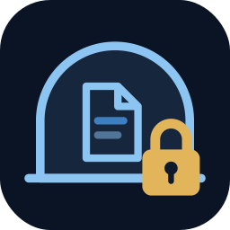
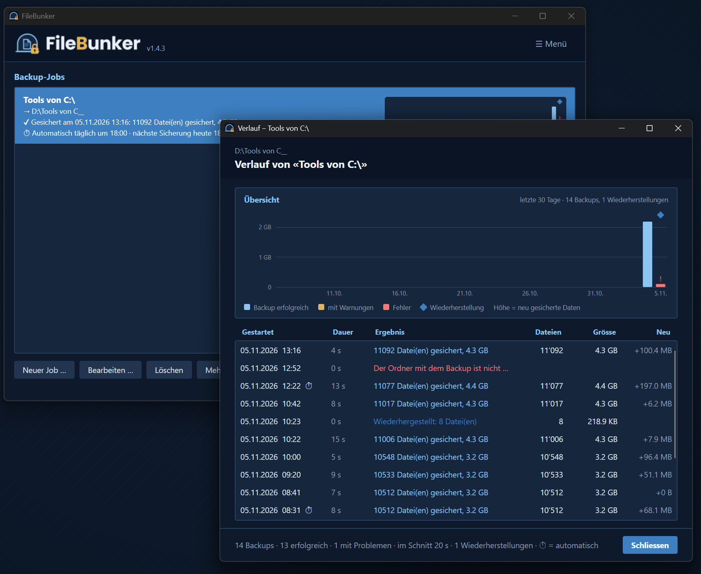

  

<h1 align="center">FileBunker</h1>

  <strong>Verschlüsseltes Backup für Windows.</strong> · <em>Encrypted backup for Windows.</em> 
  Gratis für Windows · Deutsch und Englisch · Version 1.4 · von <a href="https://mhaase.ch">mhaase software</a>

  <a href="https://github.com/mhaase-software/FileBunker/releases/latest"><strong>⬇ Download</strong></a> ·
  <a href="https://mhaase.ch/filebunker/">Website</a> ·
  <a href="https://mhaase.ch/filebunker/#faq">Häufige Fragen</a> ·
  <a href="https://mhaase.ch/en/filebunker/">English</a>

---

FileBunker sichert deine Ordner verschlüsselt und platzsparend: auf eine USB-Disk, ein Netzlaufwerk oder in einen Ordner, den Google Drive oder OneDrive synchronisiert. Automatisch nach Zeitplan, mit Versionen, die du jederzeit zurückholen kannst. Oder du spiegelst einen Ordner als normale Kopie, zum Beispiel auf ein NAS.

  

## Funktionen

- **Verschlüsselt** – AES-256-GCM. Ohne dein Passwort kann niemand die Daten lesen, auch nicht in der Cloud.
- **Platzsparend** – Dateien werden in Blöcke zerlegt, jeder Block wird nur einmal gespeichert. Dazu Komprimierung.
- **Versionen und schlaues Aufräumen** – je die neuste Version der letzten 7 Tage, 4 Wochen und 12 Monate.
- **Zeitplan und USB-Erkennung** – verpasste Sicherungen werden nachgeholt, USB-Disks am Backup erkannt.
- **Wiederherstellen mit Suche** – jede Fassung einer Datei in allen Versionen finden.
- **Sync-Jobs (Spiegeln)** – Ordner A als normale Kopie nach B, Gelöschtes 30 Tage im Papierkorb von B. Ist A plötzlich leer, wird in B nichts entfernt.
- **Verlaufsgrafik** – pro Job eine Säule pro Tag über 30 Tage, farbig nach Ergebnis.
- **Gesperrte Dateien** – z. B. Outlook über eine Windows-Schattenkopie.
- **Backup prüfen**, **Verlauf**, **E-Mail bei Fehlern**, **Umzug auf neuen PC**.
- **Deutsch und Englisch**, **hell und dunkel**.

## Mögliche Ziele

| Ziel | Hinweis |
|---|---|
| Lokale Disk | jeder Ordner auf einer internen Disk |
| USB-Disk | wird am Backup erkannt, auch mit anderem Buchstaben |
| Netzlaufwerk | z. B. ein NAS |
| Cloud | ein Ordner, den Google Drive für Desktop oder OneDrive synchronisiert |

FileBunker spricht selbst mit keinem Clouddienst.

## Download und Installation

Unter [**Releases**](https://github.com/mhaase-software/FileBunker/releases/latest) oder auf [mhaase.ch/filebunker](https://mhaase.ch/filebunker/#download):

- **FileBunker-Setup-1.4.3.exe** – installiert nur für dich, ohne Adminrechte, Deutsch oder Englisch
- **FileBunker-1.4.3.msi** – installiert für alle Benutzer nach `C:\Program Files`, für Intune oder Gruppenrichtlinien

FileBunker ist nicht digital signiert. Windows SmartScreen zeigt deshalb beim ersten Start eine Warnung: **Weitere Informationen → Trotzdem ausführen**. Die SHA-256-Prüfsumme steht bei jedem Release.

**Systemvoraussetzungen:** Windows 10 oder 11 (64 Bit).

## Wichtig

**Merk dir dein Backup-Passwort.** Ohne Passwort lassen sich die Daten nicht wiederherstellen, auch nicht durch mhaase software.

## Datenschutz

mhaase software erhält keine Dateien, Dateinamen oder Passwörter. Einmal am Tag prüft FileBunker auf mhaase.ch, ob es eine neue Version gibt (abschaltbar). E-Mails bei Fehlern gehen nur über dein eigenes Mailkonto, wenn du sie einrichtest.

## Fragen und Kontakt

- Häufige Fragen: [mhaase.ch/filebunker/#faq](https://mhaase.ch/filebunker/#faq)
- Fehler gefunden oder eine Idee? [Issue eröffnen](https://github.com/mhaase-software/FileBunker/issues) oder an kontakt@mhaase.ch schreiben.

---

FileBunker ist Freeware. Der Quellcode ist nicht öffentlich. Verwendete Bausteine: Avalonia und MailKit (MIT-Lizenz), Lizenztexte in der App unter Über → Lizenzen.
Die Software wird ohne Gewähr zur Verfügung gestellt.

© 2026 [mhaase software](https://mhaase.ch) · Deine Daten. Sicher verwahrt.
